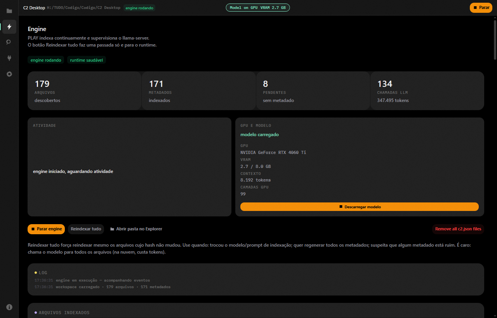
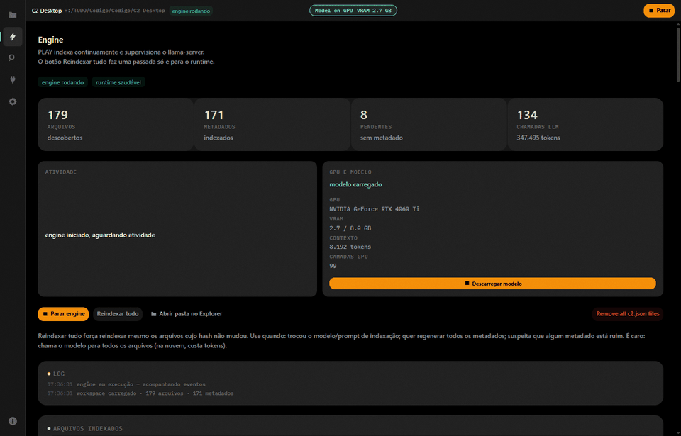
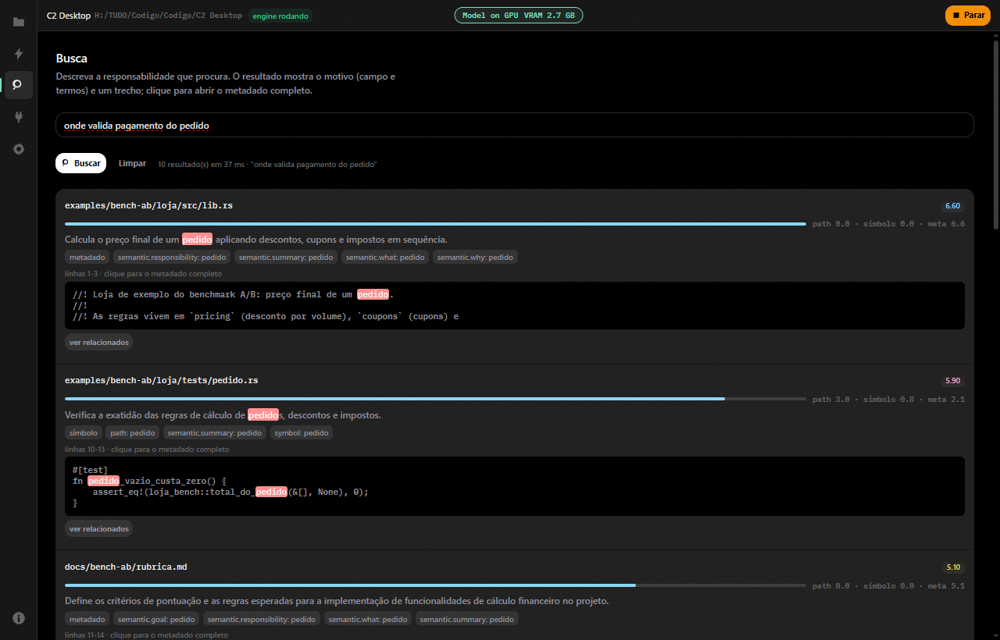
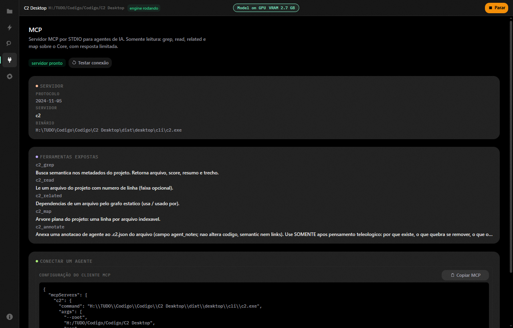

# C2

<p align="center">
  <a href="https://everctba.github.io/C2-Desktop/">
    <picture>
      <source media="(prefers-color-scheme: dark)" srcset="site/assets/img/logo-horizontal-light.png">
      
    </picture>
  </a>
</p>

<p align="center">
  
</p>

<h1 align="center">C2</h1>

<p align="center">
  <b>Comments 2.0 for AI.</b><br>
  Contexto semântico local para agentes de código — antes de ler o repositório inteiro.
</p>

<p align="center">
  
  
  
  
  <a href="https://github.com/everctba/C2-Desktop/actions/workflows/ci.yml"></a>
</p>

<p align="center">
  <a href="#começar">Começar</a> ·
  <a href="#vantagens">Vantagens</a> ·
  <a href="#como-funciona">Como funciona</a> ·
  <a href="#demo">Demo</a> ·
  <a href="#cli-e-mcp">CLI e MCP</a> ·
  <a href="docs/executar.md">Manual de execução</a> ·
  <a href="https://everctba.github.io/C2-Desktop/">Site</a>
</p>

<br>

<p align="center">
  
  <br>
  <sub><b>Engine ao vivo:</b> índice incremental, GPU/modelo e atividade de indexação no mesmo lugar.</sub>
</p>

> [!NOTE]
> **O C2 é local-first.** O modelo e o índice rodam na sua máquina. O agente que escreve o código pode ser o melhor modelo da nuvem — ele só lê o resumo. Nuvem no C2 é opcional.

O C2 comenta seu código automaticamente com IA local. Para cada arquivo, ele gera um `.c2.json` ao lado com:

```text
what · why · goal · summary · responsibility · links[]
```

O agente consulta esse contexto por significado antes de abrir o código. Resultado: **menos tokens, menos leitura, menos erro** — e o repositório continua sendo a fonte da verdade.

### O que o agente recebe

```json
{
  "what": "valida o pagamento do pedido",
  "why": "impede cobrança sem confirmação do provedor",
  "goal": "garantir que o pedido só avance após aprovação",
  "summary": "consulta o provedor e atualiza o status do pagamento",
  "responsibility": "regras de confirmação e estorno",
  "links": ["src/pagamento/provedor.rs", "src/pedido/status.rs"]
}
```

Metadado é **hipótese**; código é evidência. O C2 deixa isso explícito — e o agente confirma no código antes de editar.

<br>

## Começar

```powershell
# 1. instale o C2 (Windows)
#    baixe o instalador em github.com/everctba/C2-Desktop/releases
#    ou, no repositório:
dist\installer\C2-Setup-0.1.0.exe

# 2. abra um projeto
cd C:\meu-projeto
c2 init

# 3. a janela abre, escolha o .gguf e aguarde "modelo carregado"
```

Depois, o agente começa assim:

```bash
c2 status
c2 grep "onde o sistema valida pagamento" --limit 5
c2 related src/pagamento/servico.rs
c2 read src/pagamento/servico.rs --lines 120:180
```

Instruções completas — instalação, modelo, GPU, MCP, troubleshooting e build do zero:

<p align="center">
  <a href="docs/executar.md"><b>→ Manual de execução do C2</b></a>
</p>

<br>

## Vantagens

<table>
  <tr>
    <td width="33%" valign="top">
      <h3>📉 Menos tokens</h3>
      O agente encontra o arquivo certo pelo significado, sem abrir o repositório inteiro. Um resumo pequeno substitui milhares de tokens de código.
    </td>
    <td width="33%" valign="top">
      <h3>🎯 Menos erro</h3>
      Contexto explícito com <code>what</code>, <code>why</code>, <code>goal</code>, <code>summary</code> e <code>responsibility</code>. O agente chega no arquivo certo antes de improvisar.
    </td>
    <td width="33%" valign="top">
      <h3>🔄 Sempre atualizado</h3>
      O engine detecta arquivos novos e alterados por hash e reescreve só o metadado afetado. Uma passada incremental de 501 arquivos: <b>0,4 s · 0 chamadas</b>.
    </td>
  </tr>
</table>

### O problema de “ter tudo no contexto”

Contexto grande não é de graça:

- custa tokens e dinheiro;
- aumenta a latência;
- dilui a atenção (*lost in the middle*);
- enche o contexto com arquivos irrelevantes;
- fica desatualizado quando o código muda;
- não ajuda o modelo a saber **onde olhar**.

O C2 não joga o repositório no prompt. Ele mantém um **índice semântico local** e entrega só os candidatos certos.

### Raciocínio mais barato

Com contexto focado, o modelo gasta menos tokens em:

- procurar;
- se perder em arquivos irrelevantes;
- reconstruir dependências.

Sobra orçamento de contexto para:

- planejar;
- comparar alternativas;
- escrever testes;
- revisar.

> **Menos tokens procurando, mais tokens pensando.**

<br>

## Como funciona

```text
c2 init
  │
  ├─ C2 Desktop abre no projeto
  ├─ engine indexa os arquivos em segundo plano
  │      └─ um .c2.json ao lado de cada arquivo
  │
  └─ agente consulta:
         c2 grep "por significado"  → candidatos + evidence
         c2 related <arquivo>       → grafo de dependências
         c2 read <arquivo> --lines  → só o trecho
         c2_annotate (MCP)          → descobertas não óbvias
```

1. **Indexar** — o C2 lê o arquivo e pede a um modelo local `what/why/goal/summary`.
2. **Gravar** — o resultado vira `<arquivo>.c2.json`, com hash e links.
3. **Consultar** — agente ou você usam `grep`, `related`, `read` — sem ler tudo.

Mudou o arquivo? Só ele é reindexado. O engine roda no desktop e continua na bandeja quando você fecha a janela.

<br>

## Demo

<p align="center">
  
  <br>
  <sub>Engine → busca por significado → painel MCP. Gravação feita no app real.</sub>
</p>

<table>
  <tr>
    <td width="50%" valign="top">
      
      <br>
      <sub><b>Busca por intenção:</b> score, termos do metadado, trecho e arquivo — sem varredura cega.</sub>
    </td>
    <td width="50%" valign="top">
      
      <br>
      <sub><b>MCP pronto:</b> ferramentas somente leitura e JSON para colar no seu cliente.</sub>
    </td>
  </tr>
</table>

<br>

## Tudo no pacote

<table>
  <tr>
    <td width="33%" valign="top">
      <h3>🖥️ Desktop Tauri</h3>
      Projetos, Engine ao vivo, busca com score, painel MCP e configurações visuais. Seletor de modelo valida GGUF e VRAM antes de carregar.
    </td>
    <td width="33%" valign="top">
      <h3>⌨️ CLI `c2`</h3>
      <code>status</code>, <code>reindex</code>, <code>grep</code>, <code>related</code>, <code>read</code>, <code>start</code>, <code>logs</code>, <code>migrate</code> e gerenciamento de modelo.
    </td>
    <td width="33%" valign="top">
      <h3>🔌 MCP</h3>
      Servidor STDIO para Claude Code, Cursor e outros clientes. <code>c2_grep</code>, <code>c2_read</code>, <code>c2_related</code>, <code>c2_map</code> e <code>c2_annotate</code>.
    </td>
  </tr>
  <tr>
    <td width="33%" valign="top">
      <h3>🧠 Modelo local ou nuvem</h3>
      Runtime llama.cpp embarcado. Ou aponte para OpenAI, Groq, DeepSeek, OpenRouter, LM Studio, Ollama ou vLLM.
    </td>
    <td width="33%" valign="top">
      <h3>🕸️ Grafo sem LLM</h3>
      Imports/<code>use</code> viram arestas estáticas. <code>c2 related</code> mostra o que usa e o que é usado.
    </td>
    <td width="33%" valign="top">
      <h3>🧹 Reversível</h3>
      <code>c2 cleaner</code> remove os <code>.c2.json</code>; <code>c2 migrate</code> converte metadados antigos. O código não é alterado.
    </td>
  </tr>
</table>

## Números medidos

Projeto de benchmark com 501 arquivos:

| | |
|---|---|
| Primeira indexação | **36,7 min** (~4,4 s/arquivo) |
| Segunda passada | **0,4 s · 0 chamadas** · 501 hashes em cache |
| `c2 grep` | **p50 60 ms · p95 82 ms** |
| `c2 related` | **49 ms** |
| Pacote Windows | **~120 MB** (app + CLI + runtime llama.cpp) |

Metodologia: [`docs/bench-500.json`](docs/bench-500.json).

<br>

## CLI e MCP

```bash
c2 status                           # índice, fila, runtime, log
c2 reindex [--full] [--limit N]     # uma passada
c2 grep "por significado" --limit 5 # busca nos metadados
c2 related src/auth/session.rs      # usa / usado por
c2 read src/auth/session.rs --lines 40:95
c2 start / c2 stop                  # engine contínuo
c2 mcp                              # servidor MCP (STDIO)
```

Para agentes:

```bash
c2 init --agent   # AGENTS.md + .mcp.json + .cursor/mcp.json
```

O servidor MCP é somente leitura, exceto `c2_annotate` (notas no `.c2.json`). Nada sai da máquina no modo local.

<br>

## Privacidade

- modelo e índice rodam na sua máquina;
- segredos detectados antes do modelo (`skip`/`mask`);
- sem telemetria, sem conta, sem upload;
- no modo nuvem, o conteúdo dos arquivos vai apenas ao provedor configurado, com aviso e estimativa de custo.

## Plataformas

| Plataforma | Estado |
|---|---|
| **Windows 10/11 x64** | suportado e validado |
| Linux | build em validação; artefatos pelo workflow `build-linux` |
| macOS | planejado; cofre preparado via Keychain |

## Roadmap

- busca híbrida com **embeddings locais** sobre os resumos `.c2.json`;
- arquivos similares, domínios, metadados duplicados e links sugeridos;
- “quais arquivos mudam junto com este?”.

O grep lexical continua sendo a precisão; embeddings entram como recall semântico adicional. Acompanhe no [`bd`](AGENTS.md) — épico `c2-kga`.

<br>

## Documentação

- [Manual de execução](docs/executar.md) — instalar, rodar, GPU, MCP, troubleshooting
- [Guia completo](docs/guia.md) — configuração, comandos, segurança
- [Protocolo para agentes](docs/agent-protocol.md) — contexto antes de código
- [Regras para colar no agente](docs/agent-snippet.md)
- [Schema do metadado](docs/schema.md)
- [Benchmark](docs/bench-500.json)
- [Landing page](https://everctba.github.io/C2-Desktop/)

## Desenvolvimento

```bash
cargo build --workspace
cargo test --workspace        # 160 testes
cargo clippy --workspace --all-targets -- -D warnings
```

```powershell
pnpm --dir apps/desktop install
pwsh -File scripts/dev.ps1
```

Uso: `cargo run -p c2-cli -- --help`.

<br>

<p align="center">
  <a href="https://everctba.github.io/C2-Desktop/"><b>Site</b></a> ·
  <a href="https://github.com/everctba/C2-Desktop/releases">Releases</a> ·
  <a href="docs/executar.md">Como executar</a>
</p>

<p align="center">
  <sub>Feito com Rust, Tauri e um modelo local. Seu código continua seu.</sub>
</p>
