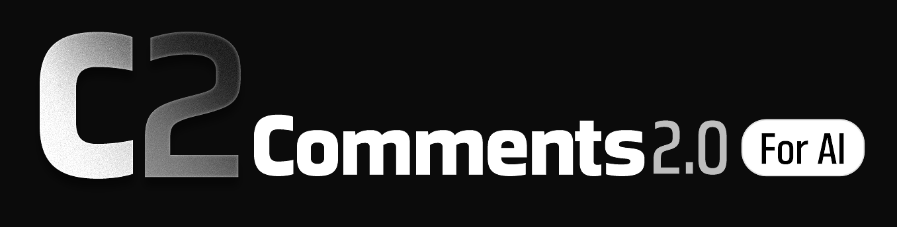

# C2

<p align="center"></p>

[](https://github.com/everctba/C2-Desktop/actions/workflows/ci.yml)

**Comments 2.0 for AI** — contexto semântico de projeto para agentes de IA.
Local. Incremental.

> **Deixe seu repo context-ready para agentes.**

O C2 comenta seu código automaticamente com IA local: `what`, `why`, `goal`,
`summary`, `responsibility`. Um loop detecta se foi criado um arquivo novo ou alterado um antigo e reescreve
só o comentário afetado, mantendo-se atualizado. Sua IA paga os arquivos `.c2.json` e consome esse comentário atualizado em vez
de reler o projeto inteiro: **menos tokens, menos erro, menos releitura.**

---

## Por que usar

- **Menos erro.** Metadado com `what`, `why`, `goal`, `summary`, `responsibility`.
- **Menos tokens.** O agente acha o arquivo certo pelo significado, sem abrir o repositório.
- **Sempre atualizado.** Você não precisa fazer nada, sempre atualizado de maneira automática.
- **Contexto pequeno e limpo.** Cada arquivo é interpretado do zero, numa requisição
  independente: sem conversa acumulada, sem contexto gigante e sem contaminação de um
  arquivo no outro — por isso roda até em máquina modesta.
- **Busca por intenção.** Descreva o que precisa em linguagem natural
  ("onde impede valores acima do limite") — o C2 procura pelo significado do
  código, não pelo nome do arquivo.
- **Resposta em milissegundos.** `c2 grep` p50 **60 ms**, `c2 related` **49 ms**;
  a consulta semântica resolve em **86 ms** o que a busca lexical não encontra.
- **Grafo sem LLM.** Imports/`use` viram arestas estáticas.
- **Anotações de agentes.** A IA principal pode salvar descobertas não óbvias
  no próprio `.c2.json` via MCP (`c2_annotate`), preservadas no reindex.
- **BYO endpoint.** Já usa LM Studio/Ollama/vLLM? Aponte o C2 para o seu
  servidor OpenAI-compatible; o mesmo seletor serve para local e nuvem.
- **Custo sob controle.** Na nuvem: preços por 1M tokens, estimativa antes do
  run, teto por execução e log em `.c2/logs/cost.jsonl`.
- **Local no contexto, não no workflow.** Modelo e índice rodam na sua máquina;
  o C2 não envia código. O agente que escreve o código pode ser o melhor modelo
  da nuvem — ele só lê o resumo. Nuvem no C2 é opcional.
- **Sem GPU?** Use um provedor OpenAI-compatible com a sua API key
  (Config → Provedor de IA). Rodar na CPU está desativado nesta versão: o modelo
  (~3–4 GB) iria para a RAM e cada arquivo levaria minutos. No modo nuvem o
  conteúdo dos arquivos é enviado ao provedor — o app avisa antes. 
- **Sem infra.** Sem banco, sem embeddings — só arquivos ao lado do código.
- **Reversível.** `c2 cleaner` remove; `c2 migrate` converte metadado antigo.

## Números medidos

| | |
|---|---|
| 501 arquivos indexados | **36,7 min** (~4,4 s/arquivo, 1ª vez) |
| 2ª passada | **0,4 s · 0 chamadas** · 501 hashes em cache |
| Busca `c2 grep` | **p50 60 ms · p95 82 ms** |
| Consulta semântica | **86 ms** acha o que o `grep` lexical não encontra |
| Pacote Windows | **117 MB** (app + CLI + runtime llama.cpp) |

Detalhe e metodologia: [docs/bench-500.json](docs/bench-500.json).

## Como funciona

1. **Indexar** — o C2 lê o código e pede a um modelo local `what/why/goal/summary`.
2. **Gravar** — o resultado vira `<arquivo>.c2.json`, com hash e links.
3. **Consultar** — agente ou você usam `grep`, `related`, `read` — sem ler tudo.

Mudou o arquivo? Só ele é reindexado.

## Começar (Windows)

```powershell
pwsh -File instalar.ps1                       # box de idioma (English padrão) + pasta + atalho + PATH
pwsh -File instalar.ps1 -Dest "D:\Apps\C2"
pwsh -File instalar.ps1 -Lang pt-BR            # instala em português (sem diálogos)
```

O instalador mostra um **box de idioma** com **English (padrão)** e **Português (Brasil)**
e grava a escolha em `%APPDATA%\dev.c2.desktop\language.json`. A interface do app
usa essa preferência e permite trocar a qualquer momento em **Config → Idioma**
(bandeiras 🇺🇸/🇧🇷); **comandos da CLI e tools do MCP continuam em inglês**.

### Instalador Windows (.exe)

O instalador oficial para Windows é gerado com **Inno Setup 6**:

```powershell
pwsh -File scripts/build-installer.ps1
# saída: dist\installer\C2-Setup-<versao>.exe (+ .sha256)
```

Ele pede **UAC/admin**, deixa escolher a pasta, instala o desktop, a CLI e o
atalho MCP (`cli\c2-mcp.cmd`), copia o runtime e adiciona `cli` ao
**PATH do sistema** (opção marcada por padrão; desmarcável). O desinstalador
remove a entrada do PATH e preserva projetos/modelos.

O `instalar.ps1` acima continua disponível para o pacote portátil (sem admin,
PATH do usuário).

Depois:

```powershell
cd meu-projeto
c2 init --agent   # grava regras para o seu agente em AGENTS.md
c2 config set model.path "H:\modelos\gemma-4-E2B-Q4_K_M.gguf"
c2 reindex
c2 grep "onde valida permissão de usuário"
```

Ou abra **C2.exe**: abrir projeto → selecionar `.gguf` → carregar na GPU → indexar → buscar.

## CLI

```bash
c2 status                           # índice, fila, runtime, log
c2 reindex [--full] [--limit N]     # uma passada
c2 start / c2 stop                  # engine contínuo / parar
c2 grep "por significado" --limit 5 # busca híbrida
c2 related src/auth/session.rs      # usa / usado por
c2 read src/auth/session.rs --lines 40:95
c2 migrate --yes                    # metadado antigo → schema v1 (com backup)
c2 logs --lines 20
```

## Desktop

Janela Tauri com **Projetos**, **Engine** (log ao vivo, contadores),
**Busca** (score, destaque dos termos, relacionados), **MCP** e **Config**
(provedor local ou nuvem com sua API key, e prompt de indexação editável).
Seletor de modelo valida cabeçalho e VRAM antes de carregar.

## MCP

```powershell
c2 --root . mcp     # STDIO: initialize, tools/list, tools/call
```

Ferramentas somente leitura: `c2_grep`, `c2_read`, `c2_related`, `c2_map`.
A única escrita é `c2_annotate` (anotações em `agent_notes` do `.c2.json`).
Configuração pronta na aba **MCP** da janela.

## Privacidade

- Modelo e índice rodam **na sua máquina**.
- Segredos são detectados **antes** do modelo (`skip`/`mask`).
- Sem telemetria. Sem upload. Sem conta.

## Plataformas

| | |
|---|---|
| Windows 10/11 (x64) | suportado e validado |
| Linux | build em validação; cofre via Secret Service (`libdbus-1`); artefatos pelo workflow **build-linux** (Actions → Run workflow) |
| macOS | planejado; cofre já preparado via Keychain |

## Quando NÃO vale

Projeto pequeno? Abrir os arquivos direto é mais barato.
O C2 compensa a partir de projetos médios, quando o agente precisaria abrir
10–20% do repositório. Medimos isso: [docs/bench-ab/resultado-cego.md](docs/bench-ab/resultado-cego.md).

## Documentação

- [Guia completo](docs/guia.md) — instalação, configuração, comandos, segurança
- [Instruções completas para agentes](docs/agent-instructions.md) — guia autocontido para colar nas regras\n- [Protocolo para agentes](docs/agent-protocol.md) — contexto antes de código
- [Schema do metadado](docs/schema.md)
- [Gate do MVP](docs/mvp-gate.md) — critérios, benchmarks, veredito
- [Landing briefing](docs/landing/briefing.md) — números e posicionamento

## Desenvolvimento

```bash
cargo build --workspace
cargo test --workspace        # 141 testes
cargo clippy --workspace --all-targets -- -D warnings
```

Uso: `cargo run -p c2-cli -- --help`.
